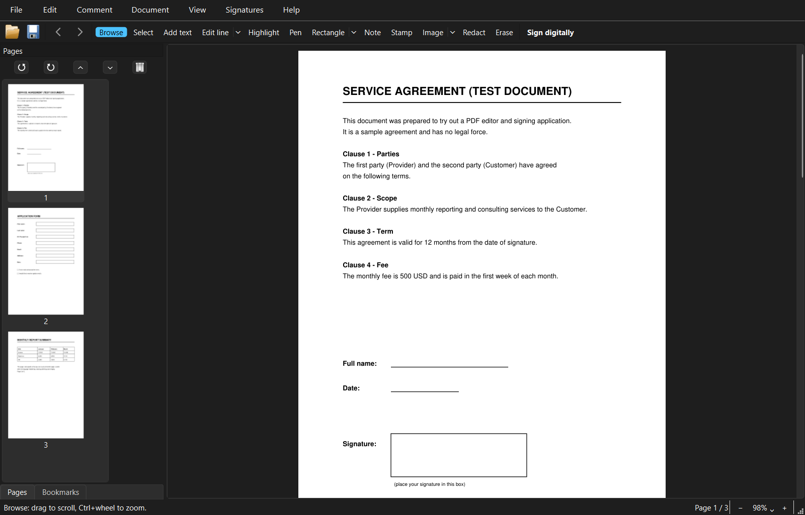

<div align="center">

# Leafpen PDF

**A free, offline PDF editor and signer for Windows.**
No accounts, no cloud, no watermarks. Your files never leave your computer.




</div>

## Features

- **Edit text**: change lines or whole paragraphs in place, or add new text. Per-word font, size, bold, italic and color; alignment and line spacing. Full Unicode support
- **Annotate**: highlight, pen, rectangle, ellipse, line, arrow, sticky notes, stamps and images, with a Select tool to move, resize and restyle them
- **Redact**: permanently remove text, images and drawings under marked areas or search matches
- **Organize pages**: rotate, delete, reorder, crop, insert pages from another PDF, extract pages
- **Page content**: watermarks, headers and footers with page numbers, bookmarks
- **Forms**: fill in existing fields, or create text, checkbox, drop-down and list fields
- **Sign**: handwritten signatures (draw, type or scan) and PAdES digital signatures with a `.p12` / `.pfx` certificate, plus offline signature verification
- **Export**: pages as PNG/JPEG, or a compressed copy of the PDF
- **Tools**: merge PDFs, split into separate PDFs (every page, every N pages or page ranges), create a PDF
  from images, protect with a password (AES-256) and permissions, remove a password, repair a damaged PDF.
  Drop several PDFs on the window to merge them, or images to make a PDF
- **Search** (Ctrl+F), **command palette** (Ctrl+K), undo/redo, recent files, and password-protected PDFs
- **English and Türkçe** interface, following your Windows language (Help › Language to change)

## Install

Download `LeafpenPDF-v<version>-win64.zip` from the [Releases](https://github.com/enderoruc/leafpen-pdf/releases) page,
extract the whole folder and run `LeafpenPDF.exe`. It needs 64-bit Windows 10 or 11 and no installer or Python.

The executable is not code-signed, so Windows SmartScreen may warn you the first time.

## Run from source

```powershell
py -m venv .venv
.venv\Scripts\python -m pip install -r requirements.txt
.venv\Scripts\python -m leafpen [file.pdf]
```

To run the tests: `.venv\Scripts\python -m pip install pytest`, then `.venv\Scripts\python -m pytest`.

To build the executable and the release zip (its SHA-256 is printed):

```powershell
.venv\Scripts\python -m pip install pyinstaller
.\build.ps1
```

## Digital signatures

- Signing never modifies the original: the signed copy is saved as `*_signed.pdf`, and signatures already in the document stay valid.
- A self-signed identity created in the app proves a document has not changed since signing, but others will not see you as "verified" unless they trust your certificate. For legally recognized signatures, use a certificate from an authorized provider. Smart cards and USB tokens are not supported.
- Verification is offline and checks against the Windows root certificate store. Certificate revocation (CRL/OCSP) is not checked.

## Known limitations

- Edited text is rewritten in Arial, Times New Roman or Courier New, whichever is closest to the original font.
- Scanned (image-only) pages cannot be edited: there is no OCR.
- Editing a digitally signed document invalidates its existing signatures. The app warns you before saving.
- Stamps are stored as images, so their text is not searchable.

## Contributing

Issues and pull requests are welcome. Please run the tests before opening a pull request.

All user-facing strings are written in English and wrapped in `tr("...")`. To add a language, copy
[`leafpen/lang/tr.py`](leafpen/lang/tr.py), translate the values and register the language in
[`leafpen/i18n.py`](leafpen/i18n.py).

## License

Leafpen PDF is licensed under the [GNU AGPL-3.0](LICENSE). This follows from PyMuPDF being AGPL-3.0:
if you distribute the application, including the compiled `.exe`, you must provide its source code under the same license.

Built with [PyMuPDF](https://github.com/pymupdf/PyMuPDF) (AGPL-3.0), [PySide6](https://www.qt.io/qt-for-python) (LGPL-3.0),
[pyHanko](https://github.com/MatthiasValvekens/pyHanko) (MIT) and [cryptography](https://github.com/pyca/cryptography) (Apache-2.0 / BSD).
Windows fonts (Arial, Times New Roman, Courier New) are not distributed; they are read from your system and embedded in the PDF you edit.
